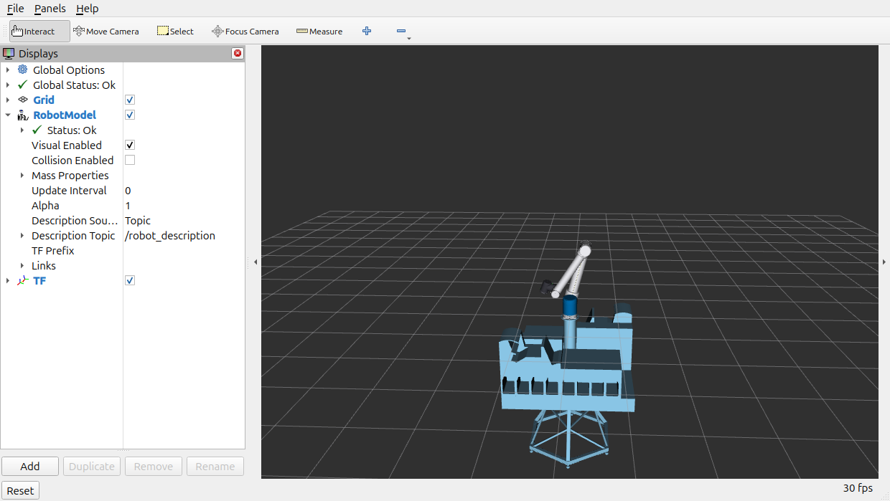
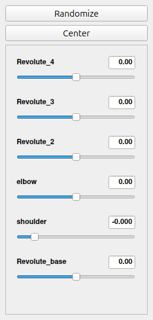

# 06 · Full scene: environment + colors

Two goals added after the 6-joint pipeline worked:

1. **Show every assembly element** — the table, stand, tube extender and the two
   glory machines next to the robot (they live in the Onshape **"Whole setup"**
   tab, not in the "UR10" tab).
2. **Show colors** — the robot looked plain white/grey in RViz.

---

## 1. Why the robot looked white/grey ("colors not showing")

Debug findings (reproducible, see the numbers):

* The exported URDF is **color-correct**: 56/56 visuals carry a `<material><color>`
  and every rgba matches the part's Onshape appearance *exactly*
  (verified part-by-part against `part_get_metadata`, e.g. JFT
  (85,220,255) → `0.333333 0.862745 1`).
* RViz renders the URDF faithfully (its `RobotLink::getMaterialForLink()`
  applies `visual->material->color` to the Ogre material).
* A pixel analysis of the RViz window proved the 3D view is rendered *correctly
  but mostly grey*: the bright pixels ((239,239,239), (104,104,106),
  (62,62,62)…) are exactly the URDF's grey values (225/180/100/50) under
  Ogre lighting.
* The few genuinely colored parts of the UR10 (`31602_step` cyan, the
  `size_3_joint_lid` blue caps, the pale-blue lids) are **thin parts seated
  inside the arm housings** — occluded from every external view.

**Conclusion:** the Onshape model itself is almost entirely grey/white
(47 of 56 parts are grey shades). RViz was never broken — there was simply
nothing colored to see from outside.

### The fix: a visible robot palette

`scripts/sync_to_ros.py` recolors the **robot** parts after the merge with a
classic Universal-Robots look (white body, blue shoulder, blue-grey elbow,
dark-grey wrists/flange), matched by part-name wildcards:

| pattern                    | color (rgba)            | what it is          |
|----------------------------|-------------------------|---------------------|
| `base*`                    | `0.80 0.82 0.85 1`      | base                |
| `size_4_joint*`            | `0.00 0.42 0.68 1`      | shoulder — UR blue  |
| `size_3_joint*`, `size_3_elbow*` | `0.28 0.33 0.40 1` | elbow housing       |
| `size_3_joint_lid*`        | `0.00 0.55 0.85 1`      | wrist lid — accent  |
| `size_2_joint*`            | `0.24 0.24 0.27 1`      | wrist joints        |
| `lower_arm`, `upper_arm`   | `0.93 0.93 0.95 1`      | body tubes — white  |
| `tool_flange`              | `0.35 0.35 0.38 1`      | tool flange         |
| `31602*`                   | `0.18 0.18 0.20 1`      | bearings            |

* The **environment keeps its real Onshape colors** (they are already
  colorful: yellow, orange, dark blue, lavender, steel blue-grey, white…).
* To keep the raw Onshape appearances for the robot as well:

  ```bash
  python scripts/sync_to_ros.py --cad-colors
  ```

* If you prefer CAD-truth colors end to end: change the appearances in the
  Onshape UI and re-run `make urdf sync build` — the export reads them
  automatically (that is exactly what the export did before the palette).

---

## 2. The environment (table / stand / tube / glory machines)

### Where it comes from

A **second, independent export** of the Onshape **"Whole setup"** tab:

```
export_env/config.json     # points at the "Whole setup" tab
export_env/environment.urdf# ONE rigid link (all its mates are FASTENED)
export_env/meshes/*.stl    # 22 meshes (table, stand parts, tubes, glory)
```

```bash
make urdf-env      # = scripts/dump_whole_setup.py + onshape-to-robot export_env/
```

Key points:

* **The robot is excluded** via `ignore` patterns in `export_env/config.json`
  (the 36 UR10 part names; verified collision-free against the 41+ environment
  part names from the `Whole setup` occurrence dump).
* All 5 mates of "Whole setup" are `FASTENED` → onshape-to-robot merges
  everything into a **single rigid link**, so the robot keeps its 6
  articulations and the environment stays static.
* `dump_whole_setup.py` also saves `export/inspect/whole_setup.json`
  (read-only API dump) — the sync needs it for the mount pose below.

### How it is aligned with the robot

The environment is exported in **"Whole setup" coordinates** (the exporter uses
an identity world transform for the root link), so aligning the cell with the
robot comes down to the **world pose of the robot's root-link frame** `R`.

That pose is taken from the robot's **root-link part occurrence**
(`UR10 <1>/Base <3>`) in the dump — the part the robot↔tube mate constrains:

```
UR10 <1>/Base <3>:  t = (0.00006, -0.0003, 0.816) m   (cumulative in W)
```

> **Why not the `UR10 <1>` sub-assembly occurrence?** Occurrence transforms are
> cumulative, and the mates move parts *relative to their sub-assembly origin*.
> The `UR10 <1>` origin sits at floor level (t = (-0.816, …)) while the mated
> base part sits **on top of the tube** at z = 0.816 — using the sub-assembly
> origin detached the robot from the tube by exactly that offset. Verified:
> with the part occurrence, robot mate connector and tube flange coincide to
> 0.6 mm (the mate is satisfied).

`sync_to_ros.py` computes, from the dump (never hard-coded):

```
T_W_R   = T_part @ inv(T_R_part)      # root-link frame in W
T_mount = inv(T_W_R)                  # env (E = W) under the robot root link
```

and appends:

```xml
<joint name="environment_mount" type="fixed">
  <parent link="base"/> <child link="environment"/>
  <origin xyz="0.00006 -0.000298 -0.816" rpy="0 0 3.14159"/>
</joint>
```

so the tube's top flange lands exactly at the robot base origin
(`base → flange` = `[0.0001, -0.0003, 0.0000]`), and the cell appears around
the robot exactly as mated in Onshape. The robot instance name is configured
by `robot_instance` in `export/config.json`.

### Cyrillic part names → ASCII

The stand is designed in Russian, so its part names (and therefore the STL
file names) are Cyrillic: `Втулка_резьбовая.stl`, `Ребро_40х40.stl`, …
Two problems are handled automatically by `sync_to_ros.py`:

1. **Mojibake from the exporter** — the emitted names arrive shifted by
   −0x350 into the Latin-1 range (`âòóëêà` = `втулка`); `_fix_mojibake()`
   shifts them back.
2. **RViz/resource_retriever prefers ASCII `package://` URIs** —
   `safe_mesh_name()` transliterates to Latin (`vtulka_rez_bovaya.stl`,
   `rebro_40kh40.stl`, …) and rewrites both the URDF references and the
   copied files (verified: 0 non-ASCII files in the package).

---

## 3. Result in RViz

* `make build && make rviz`
* 8 links (7 robot + `environment`), 7 joints (6 revolute + 1 fixed mount),
  50 STL meshes (28 robot + 22 environment).
* The robot articulates with the 6 sliders; the table/stand/tube/glory stay
  fixed around it. Fixed frame remains `base`.

Verified live (TF before/after clicking **Randomize**):

| check | before | after |
|---|---|---|
| all 6 joint positions | `0, 0, 0, 0, 0, 0` | `-0.09, -1.85, 2.04, -1.68, 1.24, -0.36` |
| `base → tool_flange` | `[-0.282, 0.175, 0.221]` | `[-0.116, 0.066, 0.984]` (arm moved) |
| `base → environment` | `[0.000, -0.000, -0.816]` | `[0.000, -0.000, -0.816]` (**fixed**) |




**Where are the "missing" colors?** The vivid yellow/orange parts are the
table's frame members (`rebro_40kh40`, `svyaz_20kh40`) at z ≈ −0.32…−0.65 m —
*i.e. underneath the tabletop*, occluded by the table itself from normal
camera angles. They render fine; orbit the camera below the table top to see
them. The lavender/light-blue parts are on the far side of the stand.

---

## 4. Troubleshooting (this feature)

| Symptom | Cause / fix |
|---|---|
| `[FAIL] whole_setup.json not found` | Run `make urdf-env` (it dumps the transform first). |
| Environment appears rotated/offset or the robot sits apart from the cell | The robot/part pose changed in Onshape → re-run `make urdf-env sync build`. |
| Robot detached from the tube (whole cell shifted) | The mount must use the robot **root-link part** occurrence, not the sub-assembly origin — see "How it is aligned with the robot" above; check `robot_instance` in `export/config.json` and re-sync. |
| `[WARN] environment mesh not found` | `export_env/meshes/` incomplete → re-run `make urdf-env`. |
| Robot is grey again | Someone synced with `--cad-colors`, or the palette patterns were edited — see `ROBOT_PALETTE` in `scripts/sync_to_ros.py`. |
| Mesh file names look like `äèñê…` | The mojibake repair did not run — update `scripts/sync_to_ros.py` (see `_fix_mojibake`) and re-sync. |
